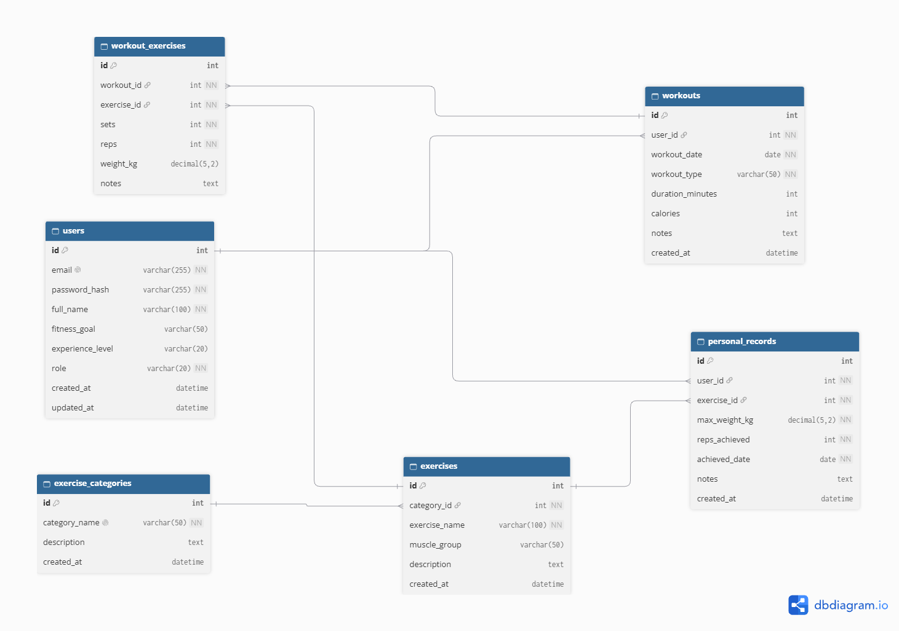

# FitnessTracker

IT 2001 Web Programming project, International Burch University, 2026/2027.

FitnessTracker is a single-page web application for logging workouts. Users record the exercises, sets,
reps and weight of each workout, browse the exercise library, track their personal records and follow
their progress over time. Admins manage the exercise library, exercise categories and users.

> Status: Milestone 1 (static SPA frontend, project structure, draft ERD). The backend is added in the next milestones.

## Technology
- Frontend: HTML, CSS, JavaScript, jQuery, Bootstrap 5, jquery.spapp (SPA)
- Backend: PHP, FlightPHP, PDO, MySQL, JWT
- Local server: XAMPP

## Entities and relationships

| Entity | Description | Relationships |
|---|---|---|
| users | accounts with a role (admin or user) | one user has many workouts and many personal records |
| exercise_categories | groups of exercises (strength, cardio, mobility...) | one category has many exercises |
| exercises | the exercise library, managed by the admin | belongs to one category; used in many workout_exercises and personal_records |
| workouts | one training session of a user on a date | belongs to one user; has many workout_exercises |
| workout_exercises | one exercise inside a workout, with sets, reps and weight | links workouts and exercises (many-to-many) |
| personal_records | a user's best lift for an exercise | belongs to one user and one exercise |

## Roles
| Role | Can do |
|---|---|
| admin | manage users, exercises and exercise categories; see all data |
| user | log, edit and delete own workouts; manage own personal records and profile; browse the exercise library |

Test accounts: added in Milestone 4.

## External API
wger Workout Manager API (https://wger.de/api/v2/): the "Discover exercises" section of the Exercise Library
lets users search exercises that are not in our library yet. Implemented in Milestone 3.

## Pages (SPA views)
The frontend is a single-page application built with jquery.spapp. Each view is a separate file in
`frontend/views/` and is loaded into `index.html` on its first visit, without a page reload.
In Milestone 1 all views are static and show sample data.

| View | Hash | Who | What it shows |
|---|---|---|---|
| Login | `#login` | everyone | sign-in form |
| Register | `#register` | everyone | sign-up form with fitness goal and experience level |
| Dashboard | `#dashboard` | user | weekly stats, recent workouts, weekly goal, latest personal records |
| Log Workout | `#workout-log` | user | workout details and exercises with sets, reps and weight |
| Workout History | `#workout-history` | user | table of own workouts with details, edit and delete |
| Exercise Library | `#exercise-library` | user | exercises grouped by category; **Discover exercises** tab (wger API) |
| Progress | `#progress` | user | statistics, strength chart (Milestone 4), personal records CRUD |
| Profile | `#profile` | user | edit profile, change password, delete account |
| Admin Panel | `#admin-panel` | admin | manage users, exercises and exercise categories |

## Running locally
1. Clone the repository into `xampp/htdocs/` and start Apache in XAMPP.
2. Open `http://localhost/<repository-folder>/frontend/`.

The app must be opened through `http://localhost`, not by double-clicking `index.html`: the views are
loaded with AJAX, and browsers block those requests for `file://` pages.

Database import and the configuration file are described from Milestone 2.

## Links
- Swagger documentation: added in Milestone 3
- Deployed application: added in Milestone 5
