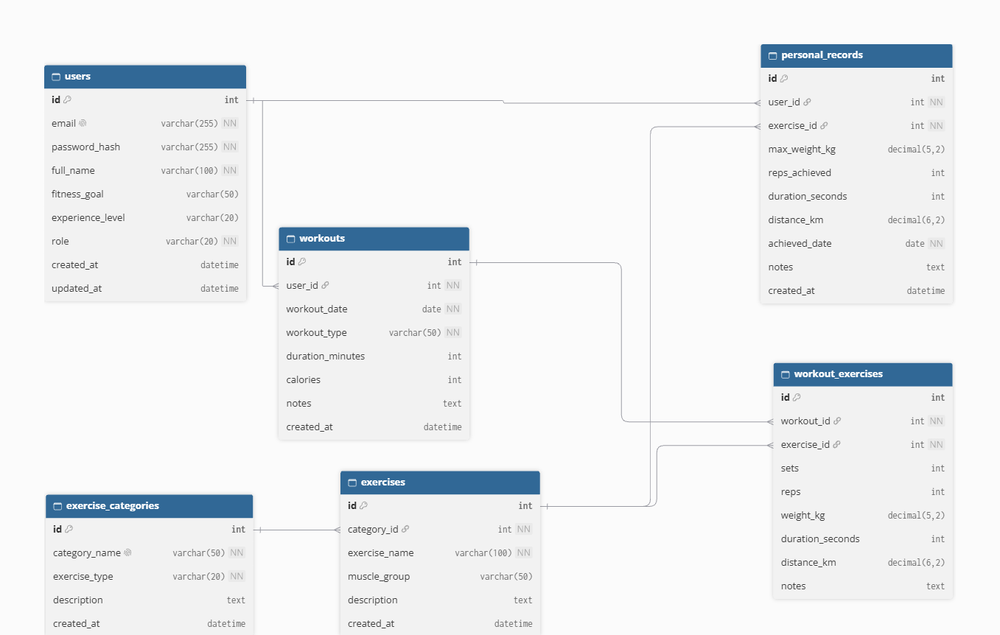

# FitnessTracker

IT 2001 Web Programming project, International Burch University, 2026/2027.

FitnessTracker is a single-page web application for logging workouts. Users record the exercises, sets,
reps and weight of each workout, browse the exercise library, track their personal records and follow
their progress over time. Admins manage the exercise library, exercise categories and users.

> Status: Milestone 3 (services, REST API, OpenAPI/Swagger, external API). Authentication and the connected frontend follow in Milestone 4.

## Technology
- Frontend: HTML, CSS, JavaScript, jQuery, Bootstrap 5, jquery.spapp (SPA)
- Backend: PHP 8.2, FlightPHP (REST API), PDO, MySQL, swagger-php (OpenAPI), Composer; JWT from Milestone 4
- Local server: XAMPP

## Entities and relationships

| Entity | Description | Relationships |
|---|---|---|
| users | accounts with a role (admin or user) | one user has many workouts and many personal records |
| exercise_categories | groups of exercises (strength, bodyweight, cardio, mobility); each category has a measurement type (weighted, bodyweight or cardio) that all its exercises use | one category has many exercises |
| exercises | the exercise library, managed by the admin, with the muscle group of each exercise | belongs to one category; used in many workout_exercises and personal_records |
| workouts | one training session of a user on a date | belongs to one user; has many workout_exercises |
| workout_exercises | one exercise inside a workout: sets, reps and weight for lifts (added weight for bodyweight), sets and duration for holds like the plank, duration and distance for cardio | links workouts and exercises (many-to-many) |
| personal_records | a user's best result for an exercise (weight x reps, a timed hold, or time and distance for cardio); a new record must beat the current one | belongs to one user and one exercise |

## Roles
| Role | Can do |
|---|---|
| admin | manage users, exercises and exercise categories; see all data |
| user | log, edit and delete own workouts; manage own personal records and profile; browse the exercise library |

Test accounts (created by `database/fitness_tracker.sql`; login works from Milestone 4):

| Role | E-mail | Password |
|---|---|---|
| admin | admin.test@example.com | Admin123! |
| user | keno.test@example.com | User123! |

## External API
wger Workout Manager API (https://wger.de/api/v2/): the "Discover exercises" section of the Exercise Library
lets users search exercises that are not in our library yet.

- Backend endpoint: `GET /external/exercises?search=squat` (`backend/rest/services/WgerService.php`). It calls
  wger `exerciseinfo` with a 5 second timeout and returns a clean list (name, category, muscles, equipment,
  short description, image, `in_library`), never the raw wger JSON.
- No API key is needed for the public exercise data; `WGER_BASE_URL`, `WGER_TIMEOUT` and `WGER_API_KEY` are in
  the configuration file anyway.
- If wger is slow or unavailable, the failure is written to `backend/logs/error.log` and the API answers 503
  with a friendly message; the rest of the application keeps working. Successful calls go to `backend/logs/info.log`.
- The UI is connected in Milestone 4.

## Pages (SPA views)
The frontend is a single-page application built with jquery.spapp. Each view is a separate file in
`frontend/views/` and is loaded into `index.html` on its first visit, without a page reload.
In Milestone 1 all views are static and show sample data.

| View | Hash | Who | What it shows |
|---|---|---|---|
| Login | `#login` | everyone | sign-in form |
| Register | `#register` | everyone | sign-up form with fitness goal and experience level |
| Dashboard | `#dashboard` | user | weekly stats, recent workouts, weekly goal, latest personal records |
| Log Workout | `#workout-log` | user | workout details and exercises with sets, reps and weight |
| Workout History | `#workout-history` | user | table of own workouts with details, edit and delete |
| Exercise Library | `#exercise-library` | user | exercises grouped by category; **Discover exercises** tab (wger API) |
| Progress | `#progress` | user | statistics, strength chart (Milestone 4), personal records CRUD |
| Profile | `#profile` | user | edit profile, change password, delete account |
| Admin Panel | `#admin-panel` | admin | manage users, exercises and exercise categories |

## Running locally
1. Clone the repository into `xampp/htdocs/` and start Apache in XAMPP.
2. Open `http://localhost/<repository-folder>/frontend/`.

The app must be opened through `http://localhost`, not by double-clicking `index.html`: the views are
loaded with AJAX, and browsers block those requests for `file://` pages.

### Database and configuration
3. Start MySQL and import `database/fitness_tracker.sql` (MySQL Workbench / DBeaver: open the file and run
   the whole script; phpMyAdmin: Import). It creates the database `fitness_tracker` with all tables and
   sample data, and can be imported again at any time to reset the data.
4. Copy `backend/config/config.example.php` to `backend/config/config.php` and set your database values
   (host, port, name, user, password). `config.php` is in `.gitignore` and is never committed.
5. Install the PHP packages: run `composer install` in the `backend` folder (creates `backend/vendor/`, which
   is not committed). `composer.json` pins the platform to PHP 8.2, so the packages also work on XAMPP's PHP.
6. Test the layers from the `backend` folder: `php rest/dao/test.php` calls every DAO method and
   `php rest/services/test.php` tries to break every business rule. Both delete everything they add.

### REST API
The API runs at `http://localhost/<repository-folder>/backend/` (Apache sends every URL to `backend/index.php`
through `backend/.htaccess`; `mod_rewrite` must be enabled, as it is in XAMPP by default).
Every error has the same JSON shape, e.g. `{"status": 404, "error": "Workout not found."}`.

| Resource | Endpoints |
|---|---|
| Users | `GET, POST /users` · `GET, PUT, DELETE /users/{id}` · `GET /users/{id}/workouts` (`?limit=`, `?from=&to=`) · `GET /users/{id}/stats` · `GET /users/{id}/personal-records` |
| Exercise categories | `GET, POST /exercise-categories` · `GET, PUT, DELETE /exercise-categories/{id}` · `GET /exercise-categories/{id}/exercises` |
| Exercises | `GET /exercises` (`?search=`, `?muscle_group=`, `?type=`) · `POST /exercises` · `GET, PUT, DELETE /exercises/{id}` |
| Workouts | `GET, POST /workouts` · `GET, PUT, DELETE /workouts/{id}` · `GET /workouts/{id}/exercises` |
| Workout exercises | `POST /workout-exercises` · `GET, PUT, DELETE /workout-exercises/{id}` |
| Personal records | `GET, POST /personal-records` · `GET, PUT, DELETE /personal-records/{id}` |
| External (wger) | `GET /external/exercises?search=` |

Until Milestone 4 (JWT) every endpoint is public and `user_id` is sent in the request; from Milestone 4 it
comes from the token.

## Links
- Swagger documentation (local): `http://localhost/<repository-folder>/backend/public/v1/docs/`
  (the OpenAPI JSON itself: `.../backend/public/v1/docs/swagger.php`)
- Deployed application: added in Milestone 5
